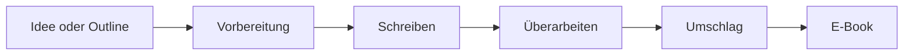

# Autorenstudio

**Deine Geschichte. Dein Ton. Dein Buch.**

Das Autorenstudio ist eine deutschsprachige Schreibwerkstatt für Autor:innen, die von der ersten Idee bis zum fertigen Kindle-E-Book begleitet werden wollen. Es hilft beim Entwickeln von Figuren, Schauplatz und Handlung, schreibt Szene für Szene und behält dabei den roten Faden im Blick. Du bestimmst, wie viel Automatik du zulässt.

> **Privater Pilot.** Der Zugang ist einladungsbasiert. Es gibt keine öffentliche Registrierung und keinen Verkauf.



## Was das Autorenstudio ist

Die meisten Schreibwerkzeuge geben dir ein leeres Blatt und lassen dich allein. Das Autorenstudio gibt dir einen Weg: Du bringst eine Idee, eine Outline oder ein vorhandenes Dokument mit. Das Autorenstudio stellt die richtigen Fragen, prüft die Struktur, entwickelt einen Stil und schreibt anschließend Szenen, die zu deiner Geschichte passen.

Der Unterschied liegt in der Kontinuität. Figuren wissen nur, was sie zu diesem Zeitpunkt wissen dürfen. Regeln, Ressourcen und Schauplätze bleiben über Kapitel hinweg konsistent. Wenn du eine frühere Szene änderst, erkennt das Autorenstudio, welche späteren Stellen davon abhängen, und baut die Kontinuität neu auf. Nichts wird still überschrieben.

Am Ende steht ein prüfbares Buch: ein reflowfähiges EPUB 3.3, ein separates Umschlagbild und ein deutscher Exportbericht mit Prüfergebnis und Herkunftsnachweisen. Du lädst das Ergebnis selbst bei Amazon KDP hoch.

## Für wen

Das Autorenstudio ist für deutschsprachige Autor:innen gemacht, die erzählende Literatur schreiben und ihren Stoff strukturiert entwickeln wollen.

| Genre | Worauf das Autorenstudio besonders achtet |
|---|---|
| **LitRPG / Progression** | Werte, Ressourcen, Fähigkeiten und ihre Grenzen, Kosten, Inventar, Terminologie und Figurenwissen. |
| **Dark Academia** | Institutionen, akademische Hierarchien, Wissensstände, Ton und Schauplatz. |
| **Domestic Thriller** | Alibis, Chronologie, Beziehungen, zurückgehaltene Motive und der Unterschied zwischen Figuren- und Leserwissen. |
| **Andere Romane** | Struktur, Perspektive, Zeit, Schauplatz, Stil und ein konsistenter roter Faden. |
| **Sachbuch (Basis)** | These, Kapitel und Abschnitte, Begriffs- und Argumentationskonsistenz sowie vom Autor gelieferte Quellen. |

Sachbücher erhalten eine grundlegende Struktur- und Schreibunterstützung. Das Autorenstudio recherchiert nicht, sucht keine Belege und behauptet nicht, faktische Aussagen verifiziert zu haben. Quellen und Bewertungen bleiben deine Angaben.

Nicht enthalten sind Zusammenarbeit in Echtzeit, öffentliche Projektlinks, eine öffentliche Manuskript-Galerie, Recherche- oder Zitationsdienste, Drucklayouts, direkte Amazon-Einreichung und mobile Apps.

## Der Weg zum Buch

1. **Projekt anlegen.** Wähle Roman oder Sachbuch, gib einen Arbeitstitel an und bringe eine Idee, eine Outline oder ein Dokument mit. Unterstützt werden eingefügter Text, Markdown und `.docx`. Ältere `.doc`-Dateien, makrofähige Dokumente, passwortgeschützte Dateien und reine Scans werden abgelehnt.
2. **Entwickeln.** Das Autorenstudio stellt fokussierte Fragen zu Prämisse, Figuren, Schauplatz und Handlung und erzeugt einen bearbeitbaren Vorschlag. Du kannst jeden Baustein überschreiben.
3. **Prüfen.** Die Kapitel werden daraufhin geprüft, ob sie ausreichend ausgearbeitet sind oder erweitert werden müssen. Vorhandene Struktur wird erhalten und nur ergänzt, wo etwas fehlt.
4. **Stil setzen.** Du legst Ton, Haltung, Distanz, Zeitform und sprachliche Eigenheiten fest — global oder kapitelweise. Du siehst eine deutsche Erklärung und bearbeitbaren Prosa-Text, keine kryptische Regelgrammatik.
5. **Outline normalisieren.** Fehlende Kapitel werden einzeln erweitert, Szenenziele von unten nach oben berechnet und die vollständige Outline mit Summen zur Prüfung vorgelegt. Von dir gelieferte Werte bleiben erhalten; fragwürdige Vorschläge werden markiert.
6. **Vorbereitung freigeben.** Outline, Stil und die erste Kontinuitätsbasis werden ausdrücklich von dir bestätigt. Diese Freigaben bleiben auch dann menschliche Gates, wenn das spätere Schreiben automatisch läuft.
7. **Schreiben.** Du entscheidest, ob das Autorenstudio eine einzelne Szene zur Prüfung vorlegt oder ein ganzes Kapitel unbeaufsichtigt durchschreibt. Ein Lauf endet spätestens am Kapitelende.
8. **Überarbeiten.** Jeder Text ist direkt bearbeitbar. Änderungen werden automatisch gespeichert, die Kontinuität wird anschließend abgeglichen. Frühere Fassungen bleiben abrufbar und können als neue Revision wiederhergestellt werden.
9. **Umschlag vorbereiten.** Lade ein fertiges Cover hoch oder lass dir Bildideen erzeugen und setze Titel und Autorennamen in einer sauberen Typografie darauf.
10. **Exportieren.** Bestätige den fertigen Stand und erhalte ein geprüftes EPUB, ein separates Umschlagbild und einen deutschen Bericht. Spätere Änderungen erzeugen einen neuen Export, statt eine bereits heruntergeladene Datei zu verändern.

## Schreibmodi und Kontrolle

Länge, Änderungsbefugnis und Widerspruchsverhalten sind getrennte Einstellungen. Eine Einstellung übernimmt nicht die Bedeutung einer anderen.

| Einstellung | Verhalten |
|---|---|
| **Szene prüfen** | Eine Szene wird entworfen und dir zur Annahme oder Überarbeitung vorgelegt. Es geht nicht automatisch weiter. |
| **Kapitel automatisch** | Das Autorenstudio schreibt der Reihe nach innerhalb eines ausgewählten Kapitels. Das nächste Kapitel wird nie automatisch begonnen. |
| **Normale Befugnis** | Änderungen sind nur im Kapitel oder Auftrag erlaubt, der beim Start festgelegt wurde. Ein Konflikt außerhalb dieses Bereichs hält den Lauf an. |
| **YOLO-Befugnis** | Zusätzlich dürfen bereits angenommene Szenen an anderen Stellen überarbeitet werden — begrenzt auf höchstens acht historische Szenen pro Lauf, mit vollständiger Aufzeichnung und Wiederherstellungsmöglichkeit. |
| **Bei Widerspruch anhalten** | Der Konflikt wird gespeichert und dir zur Entscheidung vorgelegt. |
| **Automatisch lösen** | Das Autorenstudio versucht eine begrenzte Reparatur innerhalb der erlaubten Befugnis. Ist das nicht möglich, hält der Lauf mit einer Begründung an. |

Jeder Lauf hat feste Grenzen für Aufrufe, Wörter und Kosten. Es gibt höchstens zwei automatische Reparaturversuche pro Szene. Wenn ein Limit erreicht ist, wird der Lauf angehalten; er erweitert seine eigenen Grenzen nicht. Eine laufende Aufgabe verwendet die Befugnisse, die beim Start festgehalten wurden. Spätere Einstellungsänderungen gelten nur für neue Läufe.

Die KI liefert Entwürfe. Du prüfst, änderst und gibst frei. Automatische Prüfungen unterstützen bei strukturellen und semantischen Problemen, ersetzen aber kein Lektorat und keine inhaltliche Endkontrolle.

## Kontinuität, Canon und Wissen

Das Autorenstudio führt eine versionierte Kontinuitätsbasis. Darin stehen Regeln und Verbote, sprachliche Eigenheiten, Weltmechaniken, Figuren und ihre Wissensstände, zeitliche Bezüge, Schauplätze, Motive, offene Entscheidungen und ein Verzeichnis der angenommenen Einheiten.

Jeder Kontinuitätseintrag trägt seine Herkunft: aus der Outline, aus dem Stil, aus einer konkreten Szene oder aus einer nachvollziehbaren Schlussfolgerung. Erfundene Quellen sind nicht zulässig. Wenn eine Figur etwas erst in Kapitel sechs erfährt, kann eine Szene in Kapitel drei dieses Wissen nicht verwenden.

Änderst du eine angenommene Szene, wird die Kontinuität ab der frühesten betroffenen Stelle als veraltet markiert. Der Abgleich läuft dann in Lesereihenfolge über die abhängigen Einheiten. Ein unvollständiger Abgleich wird niemals als aktuelle Kontinuität veröffentlicht. Ist die Abhängigkeit unklar, prüft das Autorenstudio konservativ alle späteren angenommenen Einheiten.

YOLO-Änderungen an bereits angenommenen Szenen werden als neue Revision gespeichert. Die alte Fassung bleibt erhalten. Eine Änderung der Outline oder des Stils kann die Kontinuität nicht still überschreiben; sie löst eine erneute Prüfung und Freigabe aus.

## Dein Manuskript gehört dir

- **Direktes Bearbeiten.** Du kannst Absätze, Überschriften, Hervorhebungen, Szenentexte sowie Vor- und Nachspann selbst schreiben und ändern. Du brauchst dafür keine KI-Freigabe.
- **Autosave.** Änderungen werden zwei Sekunden nach der letzten Eingabe gespeichert. Ein „Gespeichert“ erscheint erst, wenn der Server den Stand bestätigt hat.
- **Checkpoints.** Vor KI-Änderungen, bei ausdrücklichem Speichern, beim Verlassen einer Szene und höchstens alle fünf Minuten während längerer Bearbeitungen wird ein vollständiger Stand festgehalten.
- **Versionsgeschichte.** Du kannst eine einzelne Szene oder den Stand vor einem ganzen Lauf wiederherstellen. Die Wiederherstellung erzeugt eine neue Revision und verweist auf ihre Herkunft; die alte Geschichte wird nicht gelöscht.
- **Kein Überschreiben.** Wenn du bearbeitest, während die KI noch schreibt, kann der ältere KI-Stand deinen neueren Text nicht überschreiben. Der KI-Vorschlag wird als veraltet markiert und dir zur Entscheidung vorgelegt.
- **Wortzählung.** Gezählt werden deutsche Wortsegmente nach einer einheitlichen Regel. Automatisch aus der Outline erzeugte Überschriften zählen nicht zum Manuskriptumfang. Vor- und Nachspann zählen mit.

## Umschlag

Es gibt zwei Wege zum fertigen Cover:

1. **Fertiges Cover hochladen.** Du lädst ein JPEG oder PNG hoch. Das Autorenstudio normalisiert es auf 1600 × 2560 Pixel, sRGB, ohne automatisches Überdrucken. Titel und Autorenname bleiben, wie du sie angegeben hast.
2. **Artwork hochladen oder erzeugen lassen und typografieren.** Das Autorenstudio setzt Titel und Autorennamen deterministisch in einer von drei Vorlagen auf das Bild. Die Typografie verwendet lokale, lizenzierte Schriften, misst den Text und verkleinert ihn nur bis zu einer dokumentierten Mindestgröße. Wenn der Text nicht passt, wird das Layout abgelehnt, statt Text abzuschneiden.

Für die KI-Bildideen gibt es pro Projekt höchstens drei Stapel mit bis zu je vier Entwürfen, solange das Cover-Budget reicht. Zwölf erfolgreiche Entwürfe sind ein Ziel, keine Garantie. Fehlgeschlagene oder moderierte Versuche können das Ergebnis verringern. Ein fertig hochgeladenes Cover verbraucht kein KI-Bildbudget.

Titel und Autorenname kommen aus deinen Projektangaben. Änderst du sie später, wird die Auswahl ungültig und muss erneut bestätigt werden. Vor dem Export siehst du eine Vorschau des endgültigen JPEG.

## Export

Der Export arbeitet mit einem unveränderlichen Schnappschuss des bestätigten Manuskripts. Spätere Bearbeitungen verändern weder die bereits erzeugten Dateien noch den Bericht.

Du erhältst:

- ein reflowfähiges **EPUB 3.3** mit deutschem Titel, Autor, Sprache `de`, Titelblatt, Inhaltsverzeichnis, Kapitelnavigation, Szenenwechseln, Vor- und Nachspann sowie eingebettetem Cover,
- ein separates **`cover.jpg`** in 1600 × 2560 Pixeln,
- einen **deutschen Exportbericht** mit Snapshot-Revision, geprüften Hashes, Wort- und Kapitelzahlen, EPUBCheck-Ergebnis und Angaben zur Herkunft KI-generierter Texte und Bilder.

Das EPUB wird vor der Freigabe mit EPUBCheck geprüft. Fehler und Warnungen blockieren den Export; eine Datei mit bestandenem Lauf ist keine Garantie für die Annahme bei Amazon. Prüfe das Ergebnis zusätzlich im Kindle Previewer. Den Upload zu KDP und die Beantwortung der KI-Offenlegungsfragen übernimmst du selbst.

Download-Links sind kurzlebig und nur für dein Konto bestimmt. Exportdateien werden sieben Tage vorgehalten und können danach aus dem gespeicherten Projektstand neu erzeugt werden.

## Deine Daten

- **Ein Konto, ein Projekt, ein Eigentümer.** Es gibt keine gemeinsamen Projekte, keine öffentlichen Links und keine Leserolle.
- **Private Speicherung.** Manuskripte, Importe, Cover und Exporte liegen in privaten Speichern. Downloads laufen über kurzlebige, signierte Links; es gibt keine dauerhaft öffentlichen Manuskript-URLs.
- **Regionale Verarbeitung.** Datenbank, Anwendung und Dateispeicher sind für Frankfurt ausgelegt. Text- und Bildanbieter werden nur über freigegebene Routen mit Datenschutzfiltern angesprochen; die konkrete Verarbeitungskette wird in der Datenschutz-Dokumentation festgehalten. Eine pauschale „DSGVO-konform“-Garantie gibt es nicht.
- **Keine Recherche, keine Werkzeuge.** Das Sprachmodell erhält keinen Webzugriff, keine externen Tools und keine Möglichkeit, die Plattformregeln oder den Laufbereich zu verändern. Manuskripttext und Modellantworten werden als Daten behandelt, nicht als Anweisungen.
- **Datenexport.** Du kannst dein Konto oder einzelne Projekte als ZIP exportieren — inklusive aktueller, noch nicht abgeglichener Entwürfe, Metadaten, Outline, Stil, ausgewählter Assets und, auf Wunsch, der Versionsgeschichte.
- **Löschung.** Mit der Löschung wird der Zugriff sofort gesperrt und laufende Arbeit abgebrochen. Primäre Inhalte und Dateien werden innerhalb von sieben Tagen entfernt; Sicherungskopien laufen binnen 30 Tagen aus. Ein unabhängiger Löschmarker verhindert, dass gelöschte Inhalte durch eine Wiederherstellung zurückkehren.
- **Keine Token-Abrechnung.** Es gibt kein Token-Guthaben und keine Token-Nachbuchung. Interne KI-Kosten werden für den Betrieb überwacht, nicht als Kundenguthaben verkauft.

## Pilot und Kontingente

Das Autorenstudio ist ein geschlossener Pilot für eine kleine Gruppe eingeladener Autor:innen. Die folgenden Kontingente sind Pilotgrenzen, keine späteren Verkaufsversprechen:

| Kontingent | Pilotwert |
|---|---|
| Aktive Projekte pro Konto | 2 |
| Behaltene Manuskriptwörter pro Projekt | 250.000 |
| Ausdrückliche Überarbeitungsaufträge pro Konto und Monat | 20 |
| Cover-Stapel pro Projekt | 3 (je bis zu 4 Entwürfe) |
| Automatisch fortgeschriebene Kapitel pro Lauf | 1 |

Archivierte Projekte können keine neuen Aufgaben starten und setzen die monatlichen Zähler nicht zurück. Das Löschen und Neuanlegen eines Projekts setzt die monatlichen KI-Grenzen nicht zurück. Die internen KI-Ausgaben werden pro Konto und Organisation begrenzt; diese Grenzen sind Betriebsschutz, keine beworbenen Tarife.

Öffentliche Registrierung, Abonnements, Zahlungsabwicklung und Token-Käufe sind nicht Teil des Piloten. Preis, enthaltene Projekte, Wörter und Überarbeitungen werden erst nach der Auswertung der tatsächlichen Kosten und der Qualität festgelegt.

## Technischer Aufbau

Das Autorenstudio ist als eine TypeScript-Anwendung mit zwei Prozessen aus demselben Release aufgebaut:

| Baustein | Umsetzung |
|---|---|
| Webanwendung | Next.js 16 mit React 19 und serverseitiger Anwendungs-API |
| Manuskripteditor | Tiptap-Kern mit einem eingeschränkten Dokumentmodell |
| Datenbank und Anmeldung | Supabase PostgreSQL, Auth und private Storage-Buckets |
| Hintergrundarbeit | Kontinuierlich laufender Node.js-Worker |
| Warteschlange | PostgreSQL-Jobs mit Leases, Fencing und idempotenten Commits |
| Textmodell | Festes `mistralai/mistral-large-4-0` über eine freigegebene EU-Route |
| Bildmodell | FLUX.2 Pro über den freigegebenen EU-Endpunkt |
| E-Book-Prüfung | EPUBCheck 5.4 mit Java 21 im Worker-Image |
| Betrieb | Render in Frankfurt, getrennte verschlüsselte Sicherungen in einem separaten S3-Konto |

Jede Text- und Bildanfrage entsteht im Worker, nicht im Browser. Der Browser erhält weder Datenbank-Geheimnisse noch Anbieter-Schlüssel. Lang laufende Arbeit überlebt das Schließen des Tabs und einen Neustart des Workers; ein abgebrochener Lauf kann an seinem gespeicherten Stand fortgesetzt werden.

## Entwicklung

Voraussetzungen: Node.js 26.13.0, npm 11.20 oder neuer. Für den vollständigen lokalen Stack kommen Docker, die Supabase CLI, Java 21 und EPUBCheck hinzu.

```bash
npm ci
npm run lint
npm run typecheck
npm run test
npm run build
```

Der aktuelle, tatsächlich verifizierte Stand ist in [docs/runbook.md](docs/runbook.md) und [docs/release-report.md](docs/release-report.md) festgehalten. Die vollständige lokale Umgebung, Migrationen und Betriebsbefehle sind in der technischen Spezifikation beschrieben.

## Dokumentation

| Dokument | Inhalt |
|---|---|
| [docs/architecture.md](docs/architecture.md) | Produkt- und Architekturdesign, Anforderungen, Datenmodell, Sicherheit und Betriebsmodell |
| [docs/technical-spec.md](docs/technical-spec.md) | Verbindliche Typen, API, Datenbank, Jobs, Fehler, Tests und Deployment |
| [docs/implementation-roadmap.md](docs/implementation-roadmap.md) | 41 abhängigkeitsgeordnete Arbeitspakete von der lokalen Umgebung bis zur Pilotfreigabe |
| [docs/runbook.md](docs/runbook.md) | Übergabeprotokolle, verifizierte Befehle, Abweichungen und offene Voraussetzungen |
| [docs/release-report.md](docs/release-report.md) | Nachweisstand und verbleibende Freigaben |

## Lizenz

MIT — siehe [LICENSE](LICENSE). Copyright (c) 2026 playa77.
