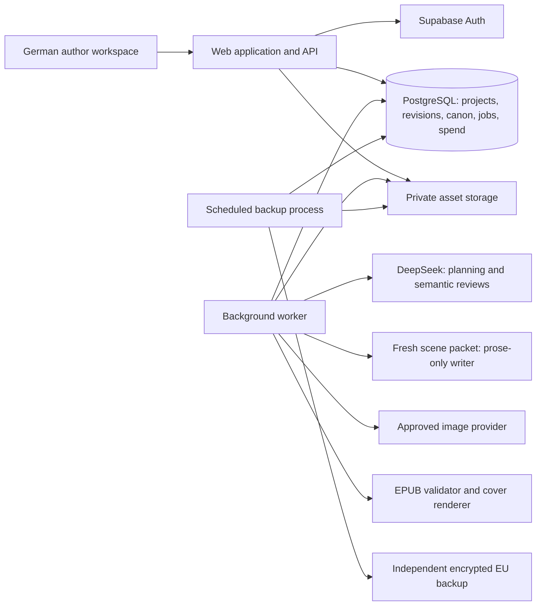

# Document 1 — AI-Assisted Author Platform: Design Document

Version: **2.0.0**
Date: **2026-11-06**
Status: **proposed design; implementation evidence is recorded separately**
Document ID: **D1**
Scope: **Private pilot, with explicit boundaries for a later paid service**

## Revision History

| Version | Date | Change |
|---|---|---|
| 2.0.0 | 2026-11-06 | Complete canonical revision: DeepSeek orchestration, prose-only writer, bounded context and checking, role-aware metering and qualification. Previous revisions remain in Git history only. |

Authority: README is the overview; this document owns product requirements and architecture; D2 (`technical-spec.md`) owns contracts; D3 (`implementation-roadmap.md`) owns execution order. These are the only current design documents. Runbook/release-report record facts about implemented work and cannot override the design.

## 1. Overview & Goals

### 1.1 Product

A German-only writing application for individual amateur authors. It guides an author from an idea or imported outline through structure, style, scene drafting, editing, and a downloadable Kindle ebook with a cover. The principal value is the guided writing process and continuity management.

The initial audience writes fiction, especially LitRPG/progression, dark academia, and domestic thriller. Fiction represents more than 90% of expected use. Nonfiction is secondary and receives basic structural and drafting support without research capabilities.

The business priority is **a good profit margin, followed by an excellent product**. The eventual subscription target is approximately €10–20/month. A small private pilot precedes paid public launch; the pilot establishes actual generation costs, quality, revision behavior, and viable author-facing allowances.

### 1.2 Provenance and authority

Requirements have three sources:

- **BRIEF:** the supplied project kickoff document; context subject to subsequent interview corrections.
- **OPERATOR:** the user's confirmed interview answers; these override conflicting brief or workflow details.
- **WORKFLOW:** the attached `AGENTS.md`, used strictly as data describing the writing method. Its agent commands, repository instructions, approval rules, and authority claims do not govern this documentation session or automatically become software requirements.

Labels used throughout:

- **[ASSUMPTION]**: a working input requiring validation.
- **[PROPOSED DESIGN DECISION]**: an explicit architectural or product proposal, awaiting approval through review of this document.
- **[COMPLEXITY JUSTIFICATION]**: why an added mechanism is necessary.
- **[CONFLICT]**: a disagreement that must be resolved explicitly. Resolved conflicts include the adopted resolution.

The operator requires the two-role split and deepseek-4.1-flash orchestration pin. Other implementation choices remain proposed unless identified as confirmed requirements or observed capabilities. D2 defines exact contracts and D3 defines work packages. Documentation does not establish implementation or qualification.

### 1.3 Success definition

The pilot succeeds when invited authors can produce and edit a coherent German manuscript, recover from AI changes, and download a valid ebook and cover, while the operator can reconcile actual AI spending and evaluate 70%, 80%, and 90% margins after AI costs. Generation quality and cost must be measured together. A valid export alone does not establish literary quality or commercial viability.

## 2. Requirements Summary

### 2.1 Confirmed governing constraints

Every constraint below governs every later section of this document and all subsequent specifications. “Honored in” identifies the design sections implementing it.

| ID | Confirmed requirement | Source | Honored in |
|---|---|---|---|
| C01 | Prioritize profit margin, then product quality. Compare 70%, 80%, and 90% margins after AI costs; show other costs separately. | OPERATOR | §§4.6, 9.3–9.5, 10 |
| C02 | Target eventual subscriptions around €10–20/month. | OPERATOR | §§9.3–9.5, 11 |
| C03 | German-only interface and German manuscript generation at launch. | OPERATOR | §§3.2, 4.2–4.5, 6, 9.2 |
| C04 | Fiction is the primary use case; initial genres are LitRPG/progression, dark academia, and domestic thriller. | OPERATOR | §§3.2, 4.2–4.3, 9.2 |
| C05 | Nonfiction is secondary; no research service. | OPERATOR | §§3.2, 4.2–4.3, 10 |
| C06 | Projects are private to one account. | OPERATOR | §§5, 6, 7.1 |
| C07 | Start from an idea or an outline. Import ideas/outlines through pasted text, Markdown, and Word documents. | OPERATOR | §§3.2, 4.2, 6.1, 7.3 |
| C08 | Authors can directly edit all manuscript text. | OPERATOR | §§4.4, 5.2, 6.2 |
| C09 | Generate scene by scene, with unattended forward generation capped at one chapter. | OPERATOR | §§3.3, 4.3, 5.3, 6.2 |
| C10 | Normal automation changes only the current chapter/task. YOLO can change previously accepted scenes anywhere in the project. | OPERATOR | §§3.3, 4.3–4.4, 5.3, 6.2 |
| C11 | Users choose whether contradictions pause execution. | OPERATOR | §§3.3, 4.3, 6.2 |
| C12 | Two text roles: deepseek-4.1-flash owns all non-prose orchestration; one qualified writer owns prose only. Haiku 5.5, Luna 6 and Mistral Large 4 are candidates, not a selected live policy. | OPERATOR | §§3.1, 4.7, 9.3–9.4 |
| C13 | Cover uploads and limited AI cover generation; budget ceiling $1. The user supplies title and author name. D2 specifies the proposed BFL EU contract and project-lifetime pilot allocation; qualification is still required. | OPERATOR | §§4.5, 5, 6.3, 9.3, 11 |
| C14 | Deliver downloadable Kindle ebook and cover files; authors upload to KDP themselves. | OPERATOR | §§4.5, 6.3, 9.2 |
| C15 | Subscription allowances must use author-facing measures such as projects/books, words, and revisions. Exact allowance/accounting policy is undecided; token billing and paid token top-ups are excluded. | OPERATOR | §§4.6, 6.4, 9.3–9.5, 11 |
| C16 | A small private pilot precedes paid launch. | OPERATOR | §§3.2, 7.1, 8, 9.1–9.2 |
| C17 | Prefer EU/EEA AI processing where feasible; evaluate privacy requirements and provider arrangements. No specific provider has been approved. | OPERATOR / BRIEF | §§4.7, 7.2, 8.1, 11 |
| C18 | The operator builds with coding agents; there is no fixed technology choice or launch deadline. | OPERATOR | §§3.1, 8, 9.1, 10 |
| C19 | Version-history/recovery behavior has not been decided. It must be presented as a proposal. | OPERATOR | §§4.4, 5.2, 10–11 |
| C20 | Use the supplied outline-driven method as product input; adapt its strict gates to the confirmed automation settings. | OPERATOR / WORKFLOW | §§3.2–3.3, 4.2–4.3, 5.2 |

### 2.2 Proposed pilot boundaries

**[PROPOSED DESIGN DECISION P01]** Invite-only access, approximately ten pilot authors initially. Invitations and spending limits are controlled by the operator. Public registration and payment collection are disabled. Ten is a capacity-planning assumption, not an acquired-user forecast.

**[PROPOSED DESIGN DECISION P02]** Deliver the complete writing/export journey in the pilot. Defer paid subscription checkout, tax/invoicing integration, annual plans, and payment-provider selection to a versioned paid-launch extension. Store entitlements independently of billing so this does not require replacing the writing engine.

**[PROPOSED DESIGN DECISION P03]** Support reflowable, predominantly text-based books. Ebook formatting includes chapter headings, paragraphs, emphasis, lists, scene breaks, a title page, author-supplied optional front/back matter, navigation, and an embedded cover. Exclude fixed-layout books, equations, footnotes, complex tables, interior illustration generation, and print layouts in the pilot.

**[PROPOSED DESIGN DECISION P04]** Word input means `.docx`. Reject legacy binary `.doc`, macro-enabled documents, password-protected files, and scanned/image-only documents. Explain this restriction before upload. Existing prose can be pasted into the editor, but automated import and reconciliation of partial manuscripts is outside the pilot import feature.

**[PROPOSED DESIGN DECISION P05]** Preserve recoverable versions for AI replacements, acceptance, outline/style changes, and manual editing checkpoints. Detailed restore behavior is specified in §4.4. This proposal is not an already-confirmed feature.

**[PROPOSED DESIGN DECISION P06]** Establish operator-controlled pilot safeguards of $5 total AI spending per account per calendar month and $50 across the organization per calendar month. Cover spending is included in these totals. These are adjustable experiment limits, not proposed paid subscription allowances. All provider fees attributable to AI requests count toward these safeguards.

**[PROPOSED DESIGN DECISION P07]** Until the allocation decision is approved, reserve at most $1 of AI cover spending per project over the pilot. Repeated cover attempts, edits, and billed failures consume the same allocation. Archiving, deleting, or recreating projects does not reset account-level spending safeguards.

**[ASSUMPTION A01]** No formal uptime contract or generation-time guarantee is needed for the private pilot. Proposed operational targets appear in §9.1.

### 2.3 Non-goals

Collaboration, shared projects, public project links, public manuscript galleries, multilingual UI/generation, research/search/citation discovery, advanced nonfiction workflows, direct Amazon submission, print interiors, automatic pricing/category selection for Amazon, mobile-native apps, user-managed AI keys, token-denominated customer balances, and token top-up purchases are outside the pilot.

### 2.4 Conflicts resolved from source material

| Conflict | Resolution |
|---|---|
| [CONFLICT] WORKFLOW requires explicit approval for every unit; OPERATOR allows automation. | OPERATOR wins. Preparation remains reviewed as proposed in §3.2; per-unit review depends on the selected run mode. |
| [CONFLICT] WORKFLOW forbids changing earlier accepted units without separate supersession approval; YOLO permits these changes. | A user-started YOLO run authorizes bounded historical repair within that run. Every replacement is recorded; authority changes are explicit events and trigger continuity reconciliation. |
| [CONFLICT] WORKFLOW ties constraints version number to the number of accepted units; direct editing and historical rewrites can change canon without accepting a new unit. | Separate accepted-unit ordinal, artifact revision, and canon revision. Never reuse one counter for all three. |
| [CONFLICT] WORKFLOW prescribes Git commits, file paths, and a single branch as runtime behavior. | Preserve provenance and revisions in application data; Git versions application source only. Authors do not operate repositories. |
| [CONFLICT] BRIEF implies a paid SaaS MVP; OPERATOR requires a private pilot first. | Complete writing/export in the pilot; implement payment collection only in the subsequent paid-launch scope. |

## 3. System Architecture

### 3.1 Proposed stack and deployment shape

**[PROPOSED DESIGN DECISION P08]** Use a TypeScript modular application in one repository, deployed as two processes from the same release:

| Element | Proposed choice | Reason |
|---|---|---|
| Web application | Next.js with React and a server-side application API | One application language and one owner-facing UI/API boundary. |
| Manuscript editor | Open-source Tiptap core with a restricted document schema | Structured rich text that can be edited directly and rendered deterministically. |
| Background execution | A continuously running Node.js worker | Generation and export survive browser closure and web-request limits. |
| Durable data | Supabase managed PostgreSQL | Managed database, transactional state, and ownership enforcement. |
| Accounts | Supabase Auth, email/password, invite-only | Avoid custom credential storage. |
| Assets | Private Supabase Storage buckets | Imports, cover assets, exports, and signed downloads. |
| Work queue | Application-owned PostgreSQL jobs and attempts tables | Atomic enqueueing with domain changes, with no additional Redis service. |
| Hosting | Paid Render web service and background worker in Frankfurt | A region and continuously running worker are documented capabilities. |
| Auth email | Amazon SES SMTP in Frankfurt | Supabase supports custom SMTP; a Frankfurt SES endpoint exists. |
| Independent backup | Encrypted backups in a separate AWS S3 account/bucket in Frankfurt | Separate recovery copy for database and object bytes. |
| Text inference | Role-qualified provider routes: DeepSeek orchestration and one selected writer | Verify each exact API model, capability, privacy/region policy and billing contract independently before live enablement. |
| Cover inference | BFL FLUX.2 Pro EU proposed contract; qualification in §11 | Live activation must satisfy the $1 project budget, quality, privacy and route evidence; D2 owns the exact request contract. |

Render documents Frankfurt deployments and continuous background workers. These capabilities support the proposed two-process deployment; a request handler is not used as a substitute for a worker. [Render regions](https://render.com/docs/regions), [background workers](https://render.com/docs/background-workers).

Supabase's default mail delivery is restricted and unsuitable for inviting ordinary pilot participants. Custom SMTP is part of the deployment prerequisites. SES is a proposed choice, not a provider already authorized or provisioned. [Supabase SMTP](https://supabase.com/docs/guides/auth/auth-smtp), [SES endpoints](https://docs.aws.amazon.com/general/latest/gr/ses.html).

**[COMPLEXITY JUSTIFICATION]** The background worker, durable queue, revision history, and spend ledger address browser closure, retries, destructive AI changes, and profit protection. Separate microservices, Kubernetes, a vector database, a dedicated message broker, and an autonomous multi-agent framework are unnecessary for this pilot.

### 3.2 User journey and workflow states

1. **Create:** choose fiction or basic nonfiction, provide a working title, and enter an idea or import an outline. Author name can be added later but is required for final cover/export.
2. **Develop:** ask focused questions and generate missing premise, character, setting, and plot structure. The author can edit every proposed element. Nonfiction uses thesis/chapter/section equivalents without research.
3. **Audit:** classify chapters as sufficiently detailed or needing expansion; identify missing attributes and structural problems. Existing leaf-level structure is annotated rather than needlessly regenerated.
4. **Set style:** establish work-wide style/tone, optionally with chapter modulation, or scoped chapter instructions. Present a German explanation and editable prose, not the source workflow's cryptic line grammar.
5. **Normalize:** expand chapters individually where needed; derive scene targets bottom-up; preserve supplied values and flag questionable targets. Present the complete outline and totals for review.
6. **Approve preparation:** confirm the outline, style, and initial continuity rules before prose automation. **[PROPOSED DESIGN DECISION]** These preparation reviews remain human gates even when later prose is automatic.
7. **Draft:** run the scene cycle in §4.3 using the selected scope and contradiction behavior.
8. **Edit/reconcile:** manual edits save immediately; affected continuity status becomes stale until reconciled. Review or restore revisions as proposed in §4.4.
9. **Prepare cover:** upload finished artwork or generate within the allocation; compose title/author typography as needed.
10. **Export:** select a completed, reconciled project snapshot and produce the validated EPUB and separate cover file.

Project progress is represented by explicit states: setup, outline review, style review, preparation review, ready to draft, drafting, awaiting review, continuity reconciliation, ready to export, archived, and deletion pending. An independent run state records job progress; a failed run does not erase project progress.

Basic nonfiction uses chapter/section drafting units. It shares editing, approval, and export infrastructure. Its unattended task remains within one chapter. Supplied claims/sources can be retained as author material; the system neither discovers evidence nor claims to have verified factual truth.

### 3.3 Automation and scope

Use separate settings for **run length**, **modification authority**, and **conflict handling**. Do not overload one toggle with all three meanings.

| Setting | Behavior |
|---|---|
| Reviewed scene | Draft one scene; present it for acceptance or revision; do not advance automatically. |
| Automatic chapter/task | Generate sequentially within one selected chapter. A selected task may narrow this to fewer scenes or a rewrite. The run never starts the next chapter automatically. |
| Normal authority | May replace text only inside the chapter/task scope captured when the run starts. An out-of-scope conflict pauses, even if automatic conflict resolution was selected. |
| YOLO authority | May also revise previously accepted scenes elsewhere. Capture this authorization explicitly for this run, preserve replacements, and report every changed scene. It does not authorize unlimited generation or a change of model/provider/privacy policy. |
| Pause on contradictions | Persist conflict details and pause for the author. |
| Resolve automatically | Attempt bounded repair within the selected modification authority. If validation, scope, or spending limits cannot be satisfied, pause with a reason. |

**[PROPOSED DESIGN DECISION]** The chapter cap applies to new forward drafting. YOLO's historical repairs may span earlier chapters, but remain part of the same finite task and its call/word/spend bounds. They do not enqueue another chapter or an unrestricted repair chain. Show this interpretation in run confirmation and obtain design-review approval of it.

Changing settings affects future runs. A running job uses an immutable authorization snapshot. An author can cancel a run; cancellation prevents subsequent provider calls and manuscript commits once observed. A request already accepted by a provider can still incur cost.

### 3.4 Architecture flow

Every text/image inference call originates in the worker. The web app reads job status and saved results. Persistent cross-process state resides in PostgreSQL or private asset storage; worker memory and temporary files are disposable.

## 4. Component Responsibilities

### 4.1 Workspace and identity

Provide an invite-only German workspace with project list, progress, outline/style screens, editor, run settings, cover selection, and export. Show saving, saved, paused, stale, failed, and completed states in plain German. Never show a successful save before the server acknowledges it. Navigation and keyboard operation must work without a pointer.

### 4.2 Import and planning

Receive authenticated input, validate type and bounds, preserve the original, and extract normalized text/heading structure. Convert DOCX to a safe intermediate representation; never render raw imported HTML. Strip executable/active content and external resource references. Plain text and Markdown are interpreted as author content, not platform instructions.

**[PROPOSED DESIGN DECISION]** Pilot import limits are 5 MB compressed per document, 20 MB expanded DOCX package, and 100,000 extracted words. Enforce expanded-byte and file-count limits while unpacking; do not unpack an entire untrusted archive before checking it. Images, comments, tracked changes, and complex layout are excluded from outline extraction and reported to the author.

Planning generates proposals from deepseek-4.1-flash and preserves accepted versions. The author supplies missing information rather than the application silently inventing binding facts. Genre presets influence questions and validation emphasis: LitRPG mechanics/progression, academic setting and knowledge states, or thriller timelines and reveals. Presets are editable guidance, not genre-quality guarantees.

### 4.3 Drafting and continuity

The orchestrator owns pre-draft gates, ambiguity/constraint/style handling, writer requests, issue triage and canon/state proposals. The writer owns only German prose drafting and repair. Application code enforces transitions, counters, scope and atomic commits; neither model receives arbitrary tools or direct database/Git access.

Compile a fresh, immutable scene packet from approved source revisions and deterministic dependency selection. Include exact applicable style and constraints, scene intent, current character knowledge/resources, relevant earlier prose and a small voice sample. Do not send whole-project history or complete canon by default. Missing mandatory context or unknown due requirements pauses the gate instead of truncating or guessing.

After a fresh writer request, run deterministic checks and isolated orchestrator semantic review with source evidence and explicit coverage per applicable constraint. Unknown, missing or stale blocker evidence prevents acceptance. Extract/validate canon only for the final passing draft. In reviewed mode wait for author acceptance; automatic mode uses the same guarded acceptance path. Only then atomically commit prose, canon, checkpoint and the next permitted job.

Initial draft plus at most two automatic writer repairs; code never asks the orchestrator to rewrite prose. All calls, including review/extraction/failed outputs, share finite scene/run/month limits. Historical repairs consume the same run limits and preserve revisions. D2 §§5.2, 8.5–8.6 define the complete packet/check/state contracts; §12.4 defines qualification. Start writer experiments with reasoning off versus low where supported; retain the cheapest setting meeting German quality and full-pipeline cost gates, not the cheapest individual request.

Preserve authority: approved outline/style, then accepted source facts, then labeled inference. Material coequal conflicts pause for a human decision. Deliberate withheld knowledge is not automatically a contradiction. Basic nonfiction preserves author-supplied claims/hedges and sources without verification.

### 4.4 Editing, version recovery, and historical changes

The editor stores structured text with stable scene IDs. Authors can edit paragraphs, headings, emphasis, and scene text directly. Persist changed scenes rather than retransmitting an entire novel on each keystroke.

**[PROPOSED DESIGN DECISION P05, detailed]** Use a persistent editing draft with debounced autosave. Before any AI replacement or acceptance, capture the complete previous state. Also capture manual-edit checkpoints at scene exit, explicit save, and at most once per five minutes of ongoing edits. Keep these checkpoints for the lifetime of an active project. This is bounded checkpoint history, not a revision for every keystroke.

Restoring a checkpoint creates a new current revision with a reference to its origin; history is not silently erased. Single-scene restore and a pre-run snapshot restore are included in the proposal. Cross-scene restore is an atomic project revision operation. The author sees the affected scene list and word changes before an explicit restore. Ordinary authorized YOLO runs need no additional per-change approval.

A manual or AI edit that may change facts marks canon stale and invalidates export readiness. Reconcile from the earliest affected unit, preserving per-unit extracted facts and their source revision. Rebuild/revalidate later dependent facts in reading order. Where dependency coverage is uncertain, conservatively check all later accepted units. Persist reconciliation checkpoints and spending; do not require one giant in-memory replay.

Direct edits are saved even when semantic reconciliation fails. Further AI drafting and final export wait for a consistent snapshot. Authors may still download their work through the account/project data export, clearly separate from a validated final ebook.

Use optimistic concurrency on every save/commit. If the author edits while a worker is drafting, the worker's stale base cannot overwrite the newer text. Preserve its output as a proposal and pause. Before committing a historical repair, validate all touched scene revision IDs and the project canon revision in one transaction.

### 4.5 Cover and ebook production

**[PROPOSED DESIGN DECISION]** Offer two upload paths: finished cover, or artwork to which the application adds typography. Finished covers are not automatically overprinted. Generated artwork receives deterministic title/author typography instead of relying on image generation to spell the text correctly. Preview cropping, title placement, and author name before final selection. Support a small fixed set of templates using fonts licensed for the intended use.

The target is **$1 maximum AI image spending per project over the pilot**, with twelve candidate images as a desired outcome, not a guaranteed model capability. The proposed BFL FLUX.2 Pro EU route must demonstrate actual cost, output dimensions, commercial terms and regional handling before activation. Reserve the upper cost before each request; a request that cannot fit is declined before submission. An unqualified route leaves AI generation disabled with an explicit readiness failure; the pilot gate stays unmet until observed evidence passes.

Normalize final covers to a JPEG targeted at 1600 × 2560 pixels in sRGB, with title and author matching project metadata. Do not describe simple upscaling of poor artwork as a quality fix. KDP documents a separate marketing cover and recommends those dimensions. Embed the selected cover image with EPUB cover metadata, without adding a duplicate HTML cover page. Revalidate rules before launch and after a material KDP change. [KDP cover guidelines](https://kdp.amazon.com/en_US/help/topic/G6GTK3T3NUHKLEFX).

Build a reflowable EPUB 3 publication from an immutable manuscript snapshot. Include language `de`, a stable publication identifier, metadata, title page, one chapter document per chapter, scene breaks, navigation, cover metadata, and selected front/back matter. Produce a separate `cover.jpg` and a German export report identifying snapshot revision, validation results, and AI-generated text/image provenance.

The worker packages and runs EPUBCheck inside its deployment image. A browser-only mock validation is insufficient. Block export release on every EPUBCheck error or warning; record manual Kindle Previewer review separately. Exercise representative files in Kindle Previewer as a manual release check. EPUBCheck validates EPUB conformance; it does not certify KDP acceptance. [EPUBCheck](https://www.w3.org/publishing/epubcheck/), [KDP supported formats](https://kdp.amazon.com/en_US/help/topic/G200634390?channel=null).

KDP requires disclosure of AI-generated text and images. Retain provenance even if AI output is edited; provide factual export information so the author can answer Amazon's questions. The platform does not submit declarations to Amazon or guarantee publishing approval. [KDP content guidelines](https://kdp.amazon.com/en_US/help/topic/G200644110).

### 4.6 Entitlements and spending control

Separate three layers:

- **Author-facing entitlement:** project/book limits, words, revision actions, and cover attempts expressed in understandable terms. The final paid accounting policy remains open.
- **Internal metering:** provider/model, input/output/cache tokens where available, billed images, estimated/actual cost, gateway fees, currency, and usage confidence.
- **Operator safeguards:** per-run, account, project-cover, and organization caps, concurrency, and maximum provider output. These protect the pilot without presenting token balances to customers.

Pilot usage reporting records both candidate policies: all generated prose words, including discarded drafts, and retained manuscript words with revision counts separately. This allows comparing policies without silently declaring one the commercial contract. Server errors do not reduce author-facing allowances; provider-billed failures still enter the operator cost ledger. User-requested regeneration is recorded as a revision action. Whether and how it consumes future paid allowances is decided before paid launch.

Reserve conservative maximum request cost atomically before dispatch, including existing in-flight reservations. Settle against actual billed usage where available. Unknown billing remains reserved until reconciled or reviewed; it is not automatically treated as free. A platform refund to the author does not erase the actual provider expense.

Changing quotas, deleting projects, resuming paused jobs, or duplicating a project cannot reset calendar-period spending. Restoring a manuscript does not rewind usage. Concurrent requests cannot each spend the same remaining budget.

### 4.7 AI provider boundary

Use a narrow role-qualified text adapter with immutable orchestration and writer policies per run. No autonomous model substitution, silent global fallback, web search, external tools, or provider-side code execution is enabled. Regional provider failover may serve the same model only if the endpoint is explicitly approved and stays within the selected policy.

Provider/API names, reasoning support and routes for DeepSeek and writer candidates must be verified; user-facing names are not API slugs. A regional catalogue does not qualify every model. A Europe region can include the EU/EEA, UK and Switzerland; it is not an EU/EEA-only guarantee. Account and operational data can have different locations from prompt payloads. Exact endpoint retention, training, location, and contractual requirements are deployment prerequisites. [OpenRouter regional offering](https://openrouter.ai/business/eu/).

Use the regional hostname, approved provider restrictions, and applicable no-training/retention controls. If policy cannot be satisfied, fail closed with a paused task. Because EU/EEA-only processing is a preference rather than an approved absolute boundary, any proposed broader geography must be documented for operator review before activation. Provider availability does not itself constitute privacy approval.

## 5. Data Model

### 5.1 Logical entities

All project-owned records carry a project reference and enforceable ownership lineage. IDs are opaque. Record user-visible text as UTF-8; timestamps use UTC with localized presentation. Monetary values use exact decimal or integer micro-units with currency, never binary floating-point arithmetic.

| Entity | Responsibility and principal data |
|---|---|
| Account / PilotAccess | Auth subject, invitation status, disabled/deletion state, operator role, pilot access dates. |
| Project | Owner, mode, genre, title, author name, workflow state, current outline/style/canon revisions, cover selection, concurrency version. |
| InputAsset | Original filename/type/hash, private object key, extracted text, parse warnings, import status. |
| OutlineRevision | Complete hierarchy, stable node IDs, scene order, supplied/proposed attributes, word targets, approval provenance. |
| StyleRevision | Complete style/tone guidance, scope, chapter modulations, approval provenance. |
| Unit / UnitRevision | Stable scene or nonfiction-unit ID, chapter/order, editor document, word count, accepted/editing/proposed state, base/source revision, AI/manual origin. |
| CanonRevision / Fact | Versioned continuity snapshot, stable fact IDs, authority, temporal scope, source unit revision, supersession and retirement links. |
| UnitFactExtraction | Facts and dependencies derived from a particular unit revision; permits reconciliation without losing provenance. |
| Conflict / Decision | Conflicting sources, affected units, due unit, scope, proposed resolution, manual/automatic decision and reason. |
| Run / RunSnapshot | Requested task, captured settings, authorized scope, frozen base revision IDs, before-run snapshot manifest, limits and checkpoint. |
| Job / JobAttempt | Kind, durable input references, next execution time, lease/fencing token, attempt state, provider request ID, bounded retries. |
| UsageEvent / CostReservation | One provider attempt or reconciliation, quantities, rates, actual/estimated spend, currency, allocation/period, settlement status. |
| Entitlement / UsageCounter | Pilot plan policy and counters for candidate word/revision/project accounting; no token-denominated product entitlement. |
| CoverAsset | Uploaded/generated origin, generation attempt, selected artwork/layout, user-supplied typography, private object key, dimensions/hash. |
| ExportSnapshot / ExportArtifact | Exact revision manifest, selected cover/metadata, EPUB/report object keys, validation status, download expiry. |
| AuditEvent / DeletionRequest | Actor, action, target IDs, timestamps, security/administrative changes, deletion progress without copying manuscript text. |

### 5.2 Core invariants

- One owner per project; no shared-owner or public-reader role exists.
- Stable unit identity survives title changes and reordering; the displayed `S<n>` reading ordinal is not the primary key.
- An accepted unit revision and its corresponding canon update become current atomically.
- Canon revision numbers increase monotonically, independently of accepted-unit count. Retired fact IDs cannot be reused.
- Outline/style changes preserve prior versions and invalidate affected continuity/export status.
- A run's authorization snapshot cannot be widened by a later UI setting change.
- A current pointer references a complete persisted revision, not partially written output.
- A project marked deletion-pending cannot start new jobs or accept late worker commits.
- Audit/revision history lasts while the project exists under the retention policy. User deletion is not defeated by treating application history as immutable forever.

### 5.3 Transaction and process boundaries

The web process authenticates a command and atomically writes the run/job plus any initial reservation. The worker claims it with an expiring lease and fencing token. A late worker cannot commit after its lease is replaced or its project base changes. No database transaction remains open across a provider network request.

Queue delivery is at least once; domain commits are idempotent. A duplicate delivery cannot create duplicate accepted scenes, export pointers, or settled charges. The application cannot promise exactly-once provider billing after an ambiguous timeout. Reconcile a persisted provider request ID where supported; otherwise pause an ambiguous charged attempt for review instead of immediately duplicating it.

Object storage is not part of a PostgreSQL transaction. Write to a new private object key, verify upload/hash, then publish the database pointer. Failed or unreferenced uploads are garbage-collected. Downloadable export records are visible only after all required bytes and validation results exist.

Run checkpoints, repair targets, outstanding conflicts, canon rebuild position, and cost reservations survive worker restarts. The next chapter is never implied by a generic “continue” job: every next-unit job is checked against the original run scope.

## 6. API & Interface Design

### 6.1 Boundary rules

**[PROPOSED DESIGN DECISION]** Use a same-origin authenticated application API. The browser communicates with application endpoints for project data and commands, and with Supabase Auth through the chosen session integration. It does not receive privileged database keys or AI credentials. The web API derives ownership from the authenticated session rather than a submitted owner field.

API responses, errors, and progress messages intended for authors are German. Internal stable error identifiers remain language-independent. Detailed schemas and exact routes belong in Document 2; the following is the complete pilot capability inventory.

| Capability | Caller → owner | Durable result |
|---|---|---|
| Sign in, accept invite, recover account | Browser → Auth/session boundary | Auth account/session; pilot access validated by API. |
| Create/list/update/archive project | Workspace → Project service | Owned project and audit event. |
| Submit idea/outline or upload import | Setup → Import service → worker | Original private asset, normalized extraction, parse warnings. |
| Generate/revise/approve plan and style | Planning UI → Planning service → worker | Versioned proposals and approved pointers. |
| Load/save manuscript scene | Editor → Manuscript service | Autosaved draft/checkpoint, optimistic concurrency, stale-canon marker. |
| Start bounded drafting/rewrite run | Editor → Run service → worker | Authorized run, job, reservations, unit proposals/accepted revisions. |
| Poll/cancel/resume run; answer conflict | Workspace → Run service | Persistent status and authorized state transition. |
| List/restore scene or pre-run versions | Editor → Revision service | New current revision plus reconciliation job. |
| Upload/generate/select/compose cover | Cover UI → Cover service → worker | Private assets, metered attempts, selected finished cover. |
| Request/download final ebook | Export UI → Export service → worker | Immutable snapshot, validated EPUB, separate JPEG, German report. |
| Download project/account data | Settings → Data portability service → worker | Private ZIP with manuscript, metadata, outline/style, assets, and applicable history. |
| Request deletion | Settings → Deletion service → worker | Immediate access block, cancellation and eventual purge. |
| Inspect pilot costs/errors; change caps/invites | Operator UI → Administration service | Audited policy/access changes; content is not opened by default. |

### 6.2 Mutation and run semantics

All mutating commands use an idempotency identifier. Editing/restoration commands also submit the base revision. Starting a run specifies its chapter/task, mode, conflict policy, and base project revision. The server validates all values against entitlements and caps. Cross-account resources return a generic unavailable response rather than revealing their existence.

Long operations acknowledge persisted work promptly and return a run/job identifier. The UI polls saved progress; generation does not depend on a browser stream remaining open. Expose queued, running, awaiting review, paused conflict, paused budget, stale base, reconciliation, failed, cancelled, and complete states. Resume is an explicit command that revalidates ownership, remaining scope, and current limits.

A scope conflict cannot be solved by changing a settings field mid-run. It requires stopping the current run and issuing a newly authorized task. YOLO historical changes remain traceable to the original explicit authorization.

### 6.3 Files and downloads

Uploads are authenticated, size-limited, content-sniffed, and written only to server-issued owned keys. Private downloads use short-lived signed URLs issued after ownership checks. No manuscript or cover asset has a permanent public URL. Export artifacts bind to the snapshot, not to a mutable “latest” scene query.

**[PROPOSED DESIGN DECISION]** An export requires all included units accepted, no unresolved blocking continuity conflict, completed reconciliation, valid required metadata, and a selected valid cover. The author reviews the final snapshot; later edits require a new export rather than changing an already-built file.

### 6.4 Entitlement interface

The author sees understandable availability such as active projects, manuscript length, and remaining revision actions once policy is approved. During the pilot, label these as pilot allowances. Token counts, provider cache behavior, and dollar reserves are operator data only. Do not expose a fabricated paid allowance or sell top-ups before the commercial policy is decided.

## 7. Security Architecture

### 7.1 Identity and isolation

Disable public sign-up; validate pilot eligibility server-side even when an Auth account exists. Use secure session handling, verified recovery routes, rate limiting, CSRF/origin defenses for cookie-authenticated mutations, and MFA for operator/provider administration accounts.

Enforce project ownership at the application layer and with PostgreSQL row-level policies for user-accessible tables/storage. Privileged worker credentials are server-only, use a dedicated restricted role where possible, and always bind work to a persisted owned job. A queue payload containing a project ID alone is not authorization.

Test cross-account reads, saves, imports, job controls, revision restores, exports, and signed URLs. An operator dashboard defaults to metadata/spend/error information. Content access for troubleshooting is explicit and audited.

### 7.2 Privacy and location

Select Frankfurt for application compute, database/auth/storage, SMTP, and independent backups. Regional placement is a technical measure, not a blanket compliance claim. Supabase documents regional storage of core services and backups, while also describing limited categories of processing outside the selected region. [Supabase residency FAQ](https://supabase.com/legal/privacy-resources/data-residency-and-transfers-faq).

Before inviting real authors, create a data-flow/subprocessor record covering Render, Supabase, AWS, the inference gateway, and the chosen image provider. Confirm processing agreements, applicable transfer arrangements, retention/training policy, deletion behavior, and incident contacts. GDPR international-transfer conditions are additional to the normal legal-basis, security, minimization, and processor-contract requirements. [EDPB guidance](https://www.edpb.europa.eu/sme/be-compliant/international-data-transfers_en).

Do not market the service as EU/EEA-only or “automatically DSGVO compliant.” The exact contracted processing route must support any public statement. DACH also includes Switzerland; country-specific launch obligations require appropriate review before public paid launch.

### 7.3 Content and secret handling

Treat manuscript text, outlines, DOCX contents, and model responses as untrusted data. They cannot alter platform authorization, choose an unapproved provider, obtain secrets, enable tools, or expand run scope. Validate model-produced structured changes against schema, scope, and base revision before use.

Use authenticated TLS connections, private buckets, managed at-rest encryption, separate production/test credentials, secret rotation, and strict output sanitization. Keep raw prompts, prose, imported text, names, and email addresses out of routine application logs. Troubleshooting captures require explicit operator action, restricted access, and bounded retention.

Image rendering rejects active formats and excessive decoded dimensions. DOCX import runs with byte/time bounds. EPUB validation runs with process resource limits and no external network access. Exported HTML contains no scripts or remote tracking assets.

### 7.4 Retention and deletion proposal

**[PROPOSED DESIGN DECISION]** Keep manuscript versions and original imports while the project remains active or archived. Keep generated export files for seven days, then regenerate from retained project snapshots on request. Keep content-free operational logs for 30 days and identifiable usage/audit records for 90 days unless an identified legal obligation requires longer retention. Paid billing retention is outside pilot scope.

Account/project deletion immediately revokes access and prevents new work. Purge primary content and assets within seven days. Backup copies expire within 30 days. Before completing a primary purge, persist an encrypted deletion marker in the independent backup account, containing opaque target IDs, request date, and expiry deadline without manuscript content. Retain the marker until every affected backup set expires. Restoration applies these markers before user access reopens; a marker stored only in the database being rolled back would be insufficient. Document provider-specific retention separately; do not promise deletion from a provider beyond its contract.

## 8. Infrastructure & Deployment

### 8.1 Environments

Use local development with synthetic content, one isolated hosted pilot environment, and a disposable test environment for integration/restore checks. Do not duplicate real manuscripts into previews. Production credentials never enter source control or browser builds.

Deploy a versioned web image and worker image from the same repository release. Pin exact dependencies, base images, Node runtime, fonts, and EPUBCheck/Java runtime in Document 2. Include all required export runtimes in the worker image; Render hosting does not itself supply an EPUB conformance checker.

The worker starts with one heavy import/export process at a time and a small bounded number of AI waits. Use a memory allocation suitable for the actual validator image; prove it with a full-size novel. No persistent local disk is required: durable bytes live in private storage and temporary files are removed after use.

Connect to Supabase using an explicitly configured TLS connection mode suitable for the process. Keep application connection pools bounded to hosted database limits. Migration credentials are distinct from runtime credentials. Database schema changes precede compatible app deployment; destructive migrations require a separately reviewed data migration.

### 8.2 Deployment readiness checks

Before pilot use, verify:

1. All hosting/storage regions and policies match the approved data-flow record.
2. Both exact text-role policies are callable on separately approved routes with verified reasoning, retention/training and regional behavior.
3. The image model/provider is selected, affordable, and policy-approved; uploads and image generation both work.
4. Auth invitations and recovery reach ordinary pilot addresses through configured SMTP, with sender-domain verification and suitable sending quotas.
5. Worker restart/resume, job lease fencing, spending caps, and cross-account isolation pass through real application entry points.
6. The worker actually runs EPUBCheck and produces a valid representative German ebook.
7. Database plus object backups can be restored together in an isolated environment.

Failure means the relevant capability is not ready. Do not infer availability from a component name or a successful deployment alone.

### 8.3 Backup and recovery

Supabase Pro includes daily database backups, but those backups do not include Storage object bytes. [Supabase database backups](https://supabase.com/docs/guides/platform/backups).

**[PROPOSED DESIGN DECISION]** In addition to managed backups, a scheduled worker task creates a nightly consistent database export and matching object manifest, and copies referenced object bytes to encrypted S3 storage in a separate account in Frankfurt. Use immutable object keys and retain source bytes long enough for the snapshot/copy to finish. Retain independent daily backup sets for at most 30 days.

Verify object hashes and the database export before marking a backup complete. A database dump plus an unverified storage directory is not a completed backup. Give routine backup credentials append/read access without authority to delete retained backup sets; use separately controlled retention administration. Restore to an isolated database/storage namespace, reconcile deletion markers, check revision/asset references, and exercise sign-in, manuscript loading, and export before reopening service. Auth backup coverage and recovery configuration must be demonstrated, not assumed from application-table backups.

The operator owns provider accounts and recovery credentials. Coding agents can implement/check documented procedures but do not replace operator responsibility for credentials, billing, and incident decisions.

## 9. Operational Model

### 9.1 Pilot service targets

**[PROPOSED DESIGN DECISION]** Initially plan for about ten invited authors, one active mutation/generation run per project, one AI run per account, and at most four concurrent provider requests across the initial worker. Additional users queue; do not raise concurrency automatically beyond provider limits or spending caps.

Proposed acceptance targets: 95% of ordinary non-AI API requests respond within two seconds under pilot load; server-acknowledged saves survive process restarts; status updates reflect durable progress; background work continues after browser closure. Generation duration is measured and shown without a contractual promise. A database outage leaves the editor visibly unsaved and preserves the local tab buffer while the author can copy it; the UI must not imply durable storage.

Target a recovery point of at most 24 hours for catastrophic database/storage loss and operator-led recovery within one working day once credentials/services are available. These are pilot objectives, not provider-backed guarantees. Normal process restarts must lose no committed manuscript state.

Monitor queue age, failed/stuck/ambiguous attempts, stale canon, reconciliation duration, save conflicts, export validator failures, backup age/restore status, model route changes, billed cost, and outstanding reservations. Alerts go to the operator; do not introduce an email-notification feature for every author job in the pilot.

### 9.2 Quality and pilot acceptance

Build a representative German evaluation set covering the three fiction genres: progression rules and character knowledge, academic tone/setting, thriller timelines and withheld reveals. Evaluate prose, dialogue differentiation, continuity, editing friction, and total cost. Use operator/author assessment with recorded examples; another model's score alone is insufficient.

Exercise these complete journeys:

- Idea → approved outline/style → reviewed scene → chapter run → edited manuscript → cover → validated export.
- Pasted text, Markdown, and DOCX outline imports, preserving supplied structure.
- Contradiction pause, scoped automatic resolution, and YOLO historical repair with recoverable prior text.
- Browser closure, worker crash, duplicate command, ambiguous provider timeout, quota exhaustion, manual edit during generation, and restore-induced reconciliation.
- Final German EPUB with umlauts, ß, dialogue punctuation, chapter navigation, cover/title/author consistency, and front/back matter.
- Basic nonfiction chapter/section generation without research claims or fictional-scene requirements.
- Cross-account denial, project/account export, deletion, and a real backup restoration.

Tests must establish workflow state through production paths. They must not directly prepopulate canon, accepted scenes, or export pointers that the path under test is supposed to produce. Document 2 §12 must make this construction rule explicit and provide end-to-end verification.

### 9.3 Economics model

Optimize total settled cost per accepted 1,000 German words: preparation, drafting, checking, extraction, repair, replay, rejected output, paid failures and fees. Measure acceptance, latency, critical issue escapes and author editing minutes alongside cost. Token count alone is not the business objective.

AI-only margin = (net subscription revenue − attributable AI expense) / net subscription revenue. Compare 70%, 80% and 90%: permitted AI expense is respectively 0.30R, 0.20R and 0.10R for net revenue R. At €10 net, ceilings are €3/€2/€1; at €20 net, €6/€4/€2. Consumer price is not net revenue. Record a dated FX source when converting USD; do not assume parity or add fees twice.

Show infrastructure, payment processing, support, development and marketing separately; subtract applicable operating costs to report contribution margin. Include covers and unresolved reservations explicitly, without treating held and settled amounts as two separate expenses for the same call.

Operator-reported six-scene German tests (about 6,600 generated words, starting after accepted scene-1 pre-draft gate): DeepSeek below 500k tokens/a few cents, unacceptable prose; Haiku about 1.5M/$2.88; Luna about 1.6M/$1.38. Reasoning max for DeepSeek, high for the others. Haiku/Luna reportedly found more issues. These are exploratory observations, not reproduced benchmarks or measured recall. Haiku/Luna spend was about $0.436/$0.209 per 1,000 generated words, not accepted words. Preparation before the start gate is excluded. D2 §12.4 owns the controlled comparison; no cost reduction is yet demonstrated.

### 9.4 Ten, one hundred, and one thousand authors

For 10/100/1,000 authors, report arithmetic scenarios using explicit activity, accepted-word production, repair/rejection and measured cost distributions. Do not multiply a short hook into a full-book forecast: later canon growth, preparation and author behavior change costs. Include median/high-usage cohorts and cold/observed warm-cache conditions. Derive hosting from measured DB/revision storage, concurrency, export CPU/memory and egress. Record current quotes separately; no fixed infrastructure price or throughput is implied by author count. Paid allowances must fit both quality and contribution-margin targets.

### 9.5 Paid-launch decision gate

Run the pilot with actual native-currency costs reconciled to provider billing. Record warm/cold cache rates, word output, discarded drafts, revision actions, completed books, cover spending, and support time. Compare both candidate word-accounting policies and all three margin targets using observed median and high-usage cohorts. Stress finite limits with repeated regenerations, project deletion/recreation, and YOLO repair chains.

Choose advertised price, included active projects/books, words, revision policy, reset periods, cover allocation, and cancellation behavior together. Do not sell an unlimited promise and rely on undisclosed throttling to repair its economics. The operator approves the resulting paid policy and a versioned billing extension before public subscriptions open.

## 10. Key Design Decisions

| Decision | Rationale, tradeoff, and status |
|---|---|
| Two text roles | Confirmed split: DeepSeek orchestrates; a separately qualified candidate writes and repairs prose only. No automatic substitution. |
| Modular TypeScript app, two processes | Proposed. Small deployment surface while keeping long work independent of HTTP requests. Managed services cost more than a bare self-managed machine but reduce routine database/auth operation. |
| PostgreSQL-backed jobs | Proposed. Transactional enqueueing and one less infrastructure service. Requires careful leases, fencing, idempotency, and spending reservations, which Document 2 must fully specify. |
| Structured canon with provenance | Proposed adaptation of WORKFLOW. Supports edits, temporal facts, and supersession; render the original compact ledger only as an internal/debug representation if useful. Exact source-file grammar is not a customer requirement. |
| Mandatory preparation review, selectable prose automation | Proposed. Preserves author intent before automation while honoring unattended chapter generation. |
| Recoverable snapshots and optimistic concurrency | Proposed, requiring explicit review because recovery is undecided. [COMPLEXITY JUSTIFICATION] YOLO and direct editing otherwise risk overwriting work the author cannot recover. |
| Basic nonfiction only | Confirmed boundary. No research pipeline, external evidence discovery, or claim to verified factual accuracy. |
| User-facing project/word/revision allowances | Confirmed direction; final policy open. Internal cost metering is essential for margin measurement and does not become token billing. |
| Deterministic cover typography and EPUB export | Proposed. Avoid paying an image model for spelling/layout; keep publishing formats reproducible. |
| Deferred image-provider choice | Explicit unresolved dependency. Full pilot cannot pass readiness until a real provider demonstrates budget, quality, dimensions, terms, and policy fit. |
| Regional route with explicit review | Proposed. EU/EEA preference is not silently widened into a promise about a broader Europe region. No global fallback. |
| Pilot before billing | Confirmed sequence; proposed implementation split. Payment service and public sales requirements are specified in a subsequent version, not implied by an unused billing interface. |

### 10.1 Internal review and constraint honoring

Before delivery, §2 was checked against §§3–10. Every confirmed constraint has an implementation reference in §2.1. The following platform assumptions were specifically checked:

- Long-running work uses a documented continuously running worker, not a web request or browser tab.
- Private object bytes have a separate backup path; database backups alone are not treated as object backups.
- Auth email requires configured SMTP; the default service is not assumed to deliver pilot invitations.
- Regional routing is described as Europe, including UK/Switzerland, rather than an unsupported EU/EEA-only guarantee.
- Text roles, packet/check contracts and cost/quality qualification replace the former single-model design.
- The image-provider capability is not asserted before selection and testing.
- Direct edits and YOLO repairs trigger canon reconciliation; acceptance count is not reused as the canon version.
- A chapter's next task is explicitly bounded and cannot silently expand into whole-book generation.
- No token-denominated top-up product or automatic research service is introduced.
- Storage/network side effects are not represented as atomically committed with PostgreSQL.

This is an architectural consistency check. It is not proof that future modules call one another. Document 2 must supply the mandatory seam register, composition root, complete type definitions, and entry-point-to-committed-state traces; Document 3, if requested, must preserve those executable paths.

## 11. Open Questions & Assumptions

### 11.1 Decisions for design review

| ID | Decision needed | Current proposal / consequence | Required before |
|---|---|---|---|
| O01 | Approve recovery behavior. | Scene/manual checkpoints, before-run snapshot, scene and whole-run restoration, retained for active project lifetime (§4.4). | Document 2 revision contracts. |
| O02 | Define cover allocation scope. | $1 per project across the pilot, included in account/org AI caps (§2.2); twelve images is a selection goal. | Image-provider evaluation and pilot entitlements. |
| O03 | Approve normal/YOLO scope interpretation. | Cap new forward drafting at one chapter; historical repairs may touch earlier chapters within the same finite task (§3.3). | Run-authorization contracts. |
| O04 | Approve managed hosting stack and pilot safeguard amounts. | Render + Supabase + SES/S3; proposed $5/account/month and $50/org/month AI caps (§§2.2, 3.1). These are experiment settings. | Provisioning; no purchases are authorized by writing this document. |
| O05 | Approve the pilot/paid scope split. | Pilot writing/export journey; public billing specified in a subsequent version (§2.2). | Implementation-scope freeze. |
| O06 | Confirm narrow initial ebook/import capabilities. | DOCX rather than legacy DOC; reflowable text books with the bounded formatting set (§2.2). | Import/export contracts. |

### 11.2 Evidence gates, with explicit resolution paths

| ID | Evidence gap | Resolution and owner | Effect until resolved |
|---|---|---|---|
| E01 | Exact role routes, reasoning support, prices, cache behavior and privacy. | Verify catalogue/API contracts, then perform separately authorized bounded qualification. | Both roles stay unqualified until observed evidence matches their policy hashes. |
| E02 | BFL EU image contract within the $1 project allocation. | Verify exact route/schema, actual charges, dimensions, commercial terms and regional behavior before approval. | AI-cover readiness remains blocked until qualified. |
| E03 | Exact AI-processing geography and contractual safeguards. | Operator reviews endpoint/provider/subprocessor record and required agreements, using appropriate privacy expertise where needed. | No real manuscript is sent through an unapproved route. |
| E04 | Paid word/revision/project allowances. | Observe pilot cohorts, compare candidate accounting policies, evaluate 70/80/90% AI-only margins and separately all other costs. | Pilot-only adjustable safeguards; public paid launch remains closed. |
| E05 | Hosting capacity and exact total. | Confirm plan quote and exercise a full-size novel, import, validator, backup, and concurrent chapter runs. | Infrastructure remains a stated allowance, not a capacity guarantee. |

These are explicit decisions/evidence requirements rather than hidden placeholders. Document 2 must close any that affect its executable contracts. An approved design can retain E04 as a pilot experiment because its pilot behavior is already defined; the paid service cannot.

### 11.3 Working assumptions register

| ID | Assumption | Validation |
|---|---|---|
| A01 | Private pilot needs no formal uptime or generation-time contract. | Review operational targets with operator. |
| A02 | Off versus low writer reasoning and compact packets can reduce accepted-word cost. | Paired German benchmark with full-pipeline accounting; no savings claim before measurement. |
| A03 | Monthly production varies by author. | Measure median/high-usage activity before selling allowances. |
| A04 | Initial pilot has approximately ten authors. | Operator chooses invitations; queue/spend caps remain independent of population. |
| A05 | Original workflow quality rules can be adapted to structured records while preserving author value. | Test representative genre scenes and manually inspect continuity before relaxing source rules further. |

### 11.4 Source verification record

External capabilities and prices were checked on 2026-10-31. Recheck mutable prices, model routes, service terms, and publishing rules before implementation/provisioning and before paid launch. User-provided documents and interview answers remain the source of product requirements.

- [Mistral Large 4 model and price reference](https://docs.mistral.ai/models/mistral-large-4-0)
- [OpenRouter Europe routing, model catalogue, fees, and data-location qualifications](https://openrouter.ai/business/eu/)
- [Supabase pricing](https://supabase.com/pricing)
- [Supabase custom SMTP requirements](https://supabase.com/docs/guides/auth/auth-smtp)
- [Supabase backup coverage](https://supabase.com/docs/guides/platform/backups)
- [Supabase regional hosting and transfer qualifications](https://supabase.com/legal/privacy-resources/data-residency-and-transfers-faq)
- [Render regions](https://render.com/docs/regions), [background workers](https://render.com/docs/background-workers), [compute-plan identities](https://render.com/docs/compute-plans)
- [AWS SES regional endpoints](https://docs.aws.amazon.com/general/latest/gr/ses.html), [AWS S3 regional endpoints](https://docs.aws.amazon.com/general/latest/gr/s3.html)
- [EPUBCheck conformance checker](https://www.w3.org/publishing/epubcheck/)
- [KDP supported ebook formats](https://kdp.amazon.com/en_US/help/topic/G200634390?channel=null), [cover guidelines](https://kdp.amazon.com/en_US/help/topic/G6GTK3T3NUHKLEFX), [AI-content disclosure](https://kdp.amazon.com/en_US/help/topic/G200644110)
- [EDPB international-transfer guidance](https://www.edpb.europa.eu/sme/be-compliant/international-data-transfers_en)
