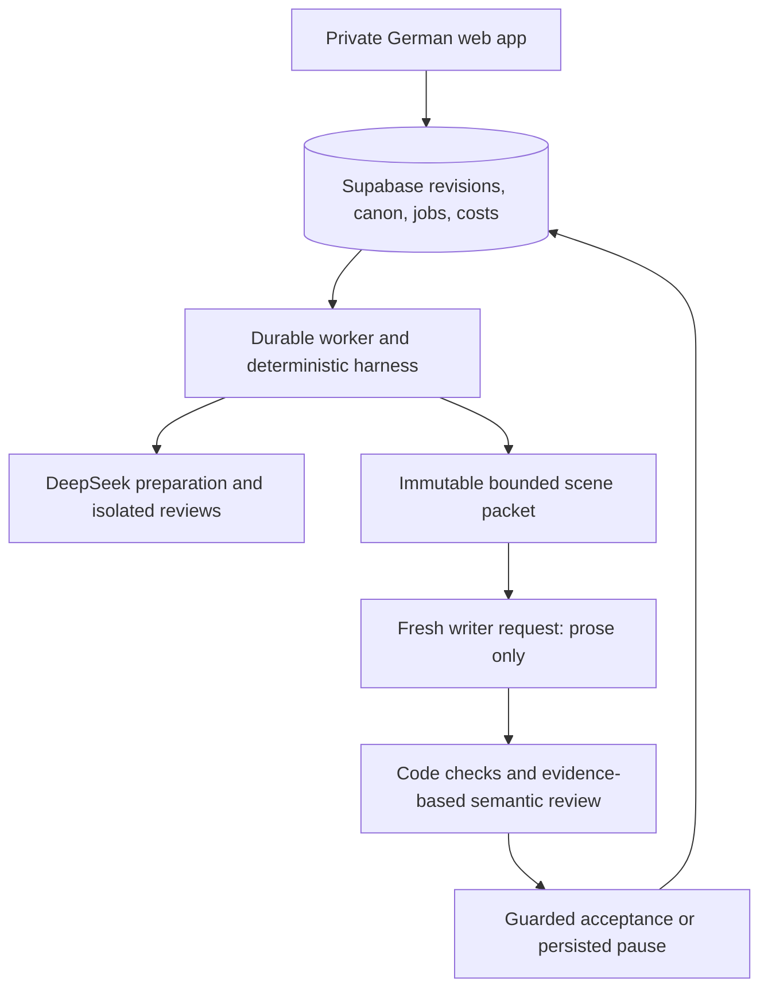

# D1 — Product and architecture

Version: **2.0.0**
Date: **2026-11-06**
Status: **draft; two-role direction requested by operator, details proposed**

## 1. Authority and reading contract

This replaces active D1 v1.0.0. The operator's new requirement supersedes
the fixed single-Mistral requirement C12.
[Writing system](writing-system.md) owns role/context/check/evaluation rules;
[D2](technical-spec.md) owns technical integration; [D3](implementation-roadmap.md)
owns sequencing. Do not repeat these contracts in prompts or handoffs.

[Historical D1](01-design-document-v1.0.0.md) preserves original decisions.
Its single-model claims and illustrative workload forecasts are superseded.
Absent D1 v1.1.0/D2 v1.0.1 references are not implementation prerequisites.

## 2. Product and economics

German writing application, one private owner per project. Fiction first:
LitRPG/progression, dark academia, domestic thriller. Basic nonfiction does not
research or verify sources. Preserve import, preparation approval, scene drafting,
editing, version recovery, private covers and ebook export.

Prioritize profitable accepted output and useful author control. The eventual
€10–20/month range is a hypothesis, not an approved price or allowance.
Private pilot only: no payments, public registration, collaboration, public
manuscripts, user API keys, research or automatic KDP submission.

Optimize total cost per accepted 1,000 German words, including preparation,
reviews, extraction, retries, rejected drafts, repairs and fees. Also measure
latency, author correction time, issue escapes and completion rate.
A token reduction that increases human repair may lose money.

AI-only margin = (net subscription revenue − attributable AI spending) /
net subscription revenue. At net revenue R, 70%/80%/90% margin targets permit
0.30R/0.20R/0.10R AI spend in the same currency. Record FX when converting USD.
Show hosting, payments, support, refunds and other operating costs separately
to calculate contribution margin. Include image spending and paid failures.
Do not sell allowances until representative and high-usage cohorts qualify.

## 3. Responsibility split

| Owner | Responsibility | Excluded authority |
|---|---|---|
| Orchestrator: deepseek-4.1-flash | All preparation, questions, gates, issues, style/constraint reviews, canon proposals, writer requests, repair management, state/checkpoint proposals | Manuscript prose generation; arbitrary tools or direct commits |
| Writer: one qualified candidate per run | Draft or revise one specified scene | Planning, checks, state, tools, self-acceptance or commits |
| Application harness | State machine, retrieval, validation, arithmetic, metering, dispatch, concurrency and atomic commits | Inventing story facts or trusting model assertions as authority |
| Author | Preparation approval, material decisions, editing and acceptance under selected mode | Hidden automation authority escalation |

Haiku 5.5, Luna 6 and Mistral Large 4 are writer candidates. The orchestration
product pin is confirmed; exact API IDs, regional/privacy handling, capabilities
and prices still need verification. No silent fallback or model substitution.

## 4. Runtime architecture

Keep Next.js/React, Supabase and one continuous Node worker. Start retrieval
with indexed IDs and explicit dependencies; no new vector database, autonomous
tool runtime or orchestration service is needed. Semantic retrieval is optional
only if measured omissions justify it; mandatory rules cannot depend on it.

The worker calls providers. Neither model gets credentials, browsing, shell or
arbitrary tools. Model action requests are typed proposals. PostgreSQL is the
source of truth; STATE.md is an optional derived projection, never another database.

## 5. Preserved boundaries

- Separate scene/chapter automation, normal/YOLO authority and contradiction
  handling. New forward generation stops at one chapter; preparation remains
  human-approved. Initial draft plus at most two automatic prose repairs.
  Historical repair shares finite run budgets; retain the existing eight-scene cap.
- Author edits cannot be overwritten by stale results. Snapshot before AI changes;
  restore creates a new revision. Accept text/canon/checkpoint/next job atomically
  with source guards, leases/fencing and idempotency.
- Reconcile dependent scenes after edits before declaring canon current.
  Sources, not summaries or review assertions, govern continuity.
- Private ownership and expiring downloads; treat imports/model output as data.
  Keep credentials and manuscript content out of logs.
- Private covers, deterministic typography, immutable EPUB/JPEG/report.
  EPUBCheck warnings/errors block export; no Amazon acceptance guarantee.
- Export includes unreconciled drafts. Deletion denies access immediately;
  primary purge within seven days, backup expiry within 30 days.
  Independent deletion markers survive primary loss.
- Approve regional/privacy behavior independently for both text roles and images.
  New models do not inherit Mistral's route approval or EU availability.
- Reserve before paid dispatch, reconcile billing, never retry ambiguous POSTs
  blindly. Cheap models still require financial controls.

[D2](technical-spec.md) selects unchanged storage, security, export and recovery
detail from the historical specification.

## 6. Evidence and status

The operator's six-scene experiments motivate this design, not a proven savings
claim; see [benchmark evidence](writing-system.md#7-evaluation-and-unit-economics).
Only the shell/contracts foundation exists. First migrate policy contracts,
then implement the compiler/checker and one-scene vertical slice with fakes.
Perform capped live qualification only when explicitly authorized.
Choose writer and reasoning setting on German quality and total accepted cost.
